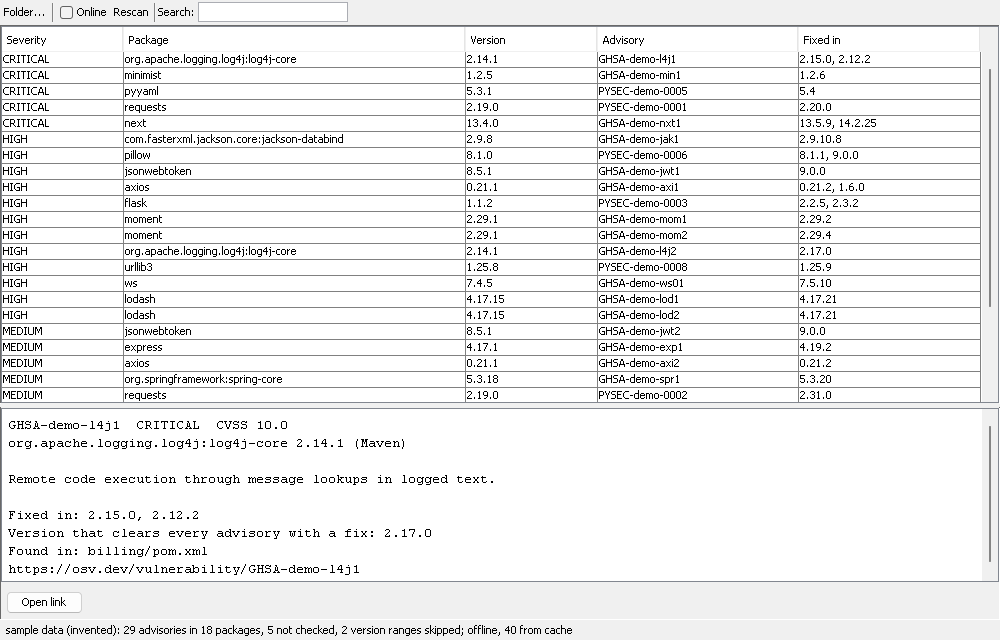

# depcheck

Walks a folder of repos, finds dependency manifests and lock files, and checks the exact versions it can resolve against [OSV.dev](https://osv.dev). Java 21, no dependencies.

By default it makes no network calls: it lists what it found and applies any advisories already in the local cache. `--online` is the only thing that talks to the network, and what it sends is the package name, ecosystem and version of each resolved package (nothing else about your machine or repos).

## Build

    build.cmd test      (Windows)
    ./build.sh test     (Linux/macOS)

This produces `depcheck.jar`; with `test` it also runs the test suite (a small runner in `test/`, no framework).

## Use

    java -jar depcheck.jar C:\src                 # inventory only, plus cached results if any
    java -jar depcheck.jar C:\src --online        # query OSV, fill the cache
    java -jar depcheck.jar C:\src --online --json > report.json
    java -jar depcheck.jar C:\src --cache-dir D:\osv --ttl-hours 72

Exit status is 1 when a vulnerable package is found, 0 when not, 2 for bad arguments or a network/API error. A run against `samples/old` (lodash 4.17.15, requests 2.19.0) with `--online` finds 16 advisories and exits 1; rows are sorted by severity, then score, with the advisory id, package, version, fixed-in version and an osv.dev link.

The cache is one file, `osv-cache.json`, in `--cache-dir` (default `~/.depcheck-cache`). Entries older than `--ttl-hours` (24 by default) are ignored; an offline run does not refresh them, so after the TTL you need `--online` again to see advisories.

## Window

    java -jar depcheck.jar gui
    java -jar depcheck.jar gui C:\src --cache-dir D:\osv

A plain Swing window with the system look and feel. The table lists one row per advisory (severity, package, version, advisory id, fixed-in versions); selecting a row shows the summary, the version that clears every advisory with a fix, the files the package was found in, and an Open link button that sends the osv.dev page to your default browser. The search box filters on package, advisory id, severity or ecosystem. Packages with no advisories are not listed; the status line says how many were not checked or only had a version range.

Online starts unchecked, so the window reads the cache only. Ticking it queries OSV for the folder shown, same as `--online` on the command line, and rescans.

`gui --snapshot out.png [--size WxH]` renders the window with invented sample data (no scan, no network) and works with `java.awt.headless=true`; that is how the screenshot above and the CI smoke test are made.

## What it reads

package-lock.json (v1 and v2/v3), package.json, requirements.txt, pyproject.toml (`[project]` and Poetry tables), pom.xml, build.gradle / build.gradle.kts, Cargo.lock, go.mod, composer.lock. `node_modules`, `.git`, `target`, `build`, `venv`/`.venv` and `vendor` directories are skipped.

## Known gaps

- The window has only been run headless (the snapshot) here, never on a live display. The screenshot is that render, so it shows no row highlight.
- Only exact versions are checked. A range such as `^1.2.0` or `>=3` in a manifest is listed as unresolved and skipped; the lock file entry is what gets checked.
- The parsers are hand-written and line/regex based. pom.xml only resolves `${property}` values defined in the same file (no parent POMs, no BOMs), and Gradle version catalogs and variables are not followed. pyproject.toml is not a full TOML parser.
- Severity comes from the advisory's own label, or from a CVSS v3 vector if there is one. Advisories with neither (many older PYSEC entries) show as UNKNOWN. CVSS v4 vectors are ignored.
- Advisories are matched on the version only; it does not know whether your code calls the vulnerable function.
